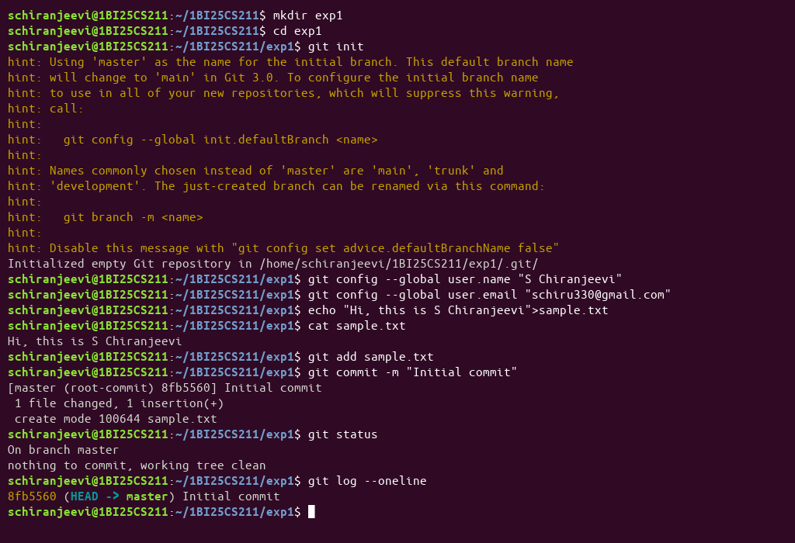

# Program 1: Setting Up and Basic Commands
**Student Name:** S Chiranjeevi  
**USN:** 1BI25CS211  
**Course:** Project Management (With Git) - 1BCSL307A  

## Aim
Initialize a new Git repository in a directory. Create a new file, add it to the staging area, and commit the changes with an appropriate commit message.

## Step-by-Step Commands & Explanations

### Step 1: Create a separate dedicated directory for Program 1 and navigate into it
```bash
mkdir exp1 && cd exp1
```

### Step 2: Initialize an empty Git repository
```bash
git init
```

### Step 3: Configure global Git user identity
```bash
git config --global user.name "S Chiranjeevi"
git config --global user.email "schiru330@gmail.com"
```

### Step 4: Create a sample file containing student identification
```bash
echo "Hi, this is S Chiranjeevi" > sample.txt
```

### Step 5: Display the content of sample.txt
```bash
cat sample.txt
```

### Step 6: Add the file to the Git staging area
```bash
git add sample.txt
```

### Step 7: Commit staged changes to local repository
```bash
git commit -m "Initial commit"
```

### Step 8: Check repository working tree and index status
```bash
git status
```

### Step 9: View commit history in single-line format
```bash
git log --oneline
```

## Output Screenshot

