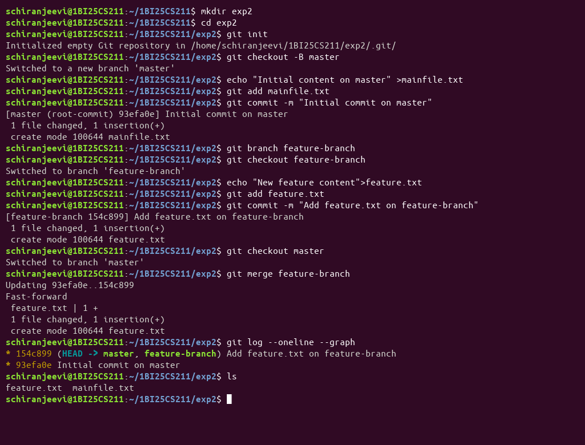

# Program 2: Creating and Managing Branches
**Student Name:** S Chiranjeevi  
**USN:** 1BI25CS211  
**Course:** Project Management (With Git) - 1BCSL307A  

## Aim
Create a new branch named 'feature-branch'. Switch to the 'master' branch. Merge 'feature-branch' into 'master'.

## Step-by-Step Commands & Explanations

### Step 1: Create and navigate into directory for Program 2
```bash
mkdir exp2 && cd exp2
```

### Step 2: Initialize repository and switch to master branch
```bash
git init && git checkout -B master
```

### Step 3: Create base file and commit on master
```bash
echo "Initial content on master" > mainfile.txt
git add mainfile.txt
git commit -m "Initial commit on master"
```

### Step 4: Create new branch 'feature-branch' and switch to it
```bash
git branch feature-branch
git checkout feature-branch
```

### Step 5: Create feature file and commit on feature-branch
```bash
echo "New feature content" > feature.txt
git add feature.txt
git commit -m "Add feature.txt on feature-branch"
```

### Step 6: Switch back to master branch
```bash
git checkout master
```

### Step 7: Merge feature-branch into master (fast-forward merge)
```bash
git merge feature-branch
```

### Step 8: Inspect commit graph and list directory files
```bash
git log --oneline --graph
ls
```

## Output Screenshot

