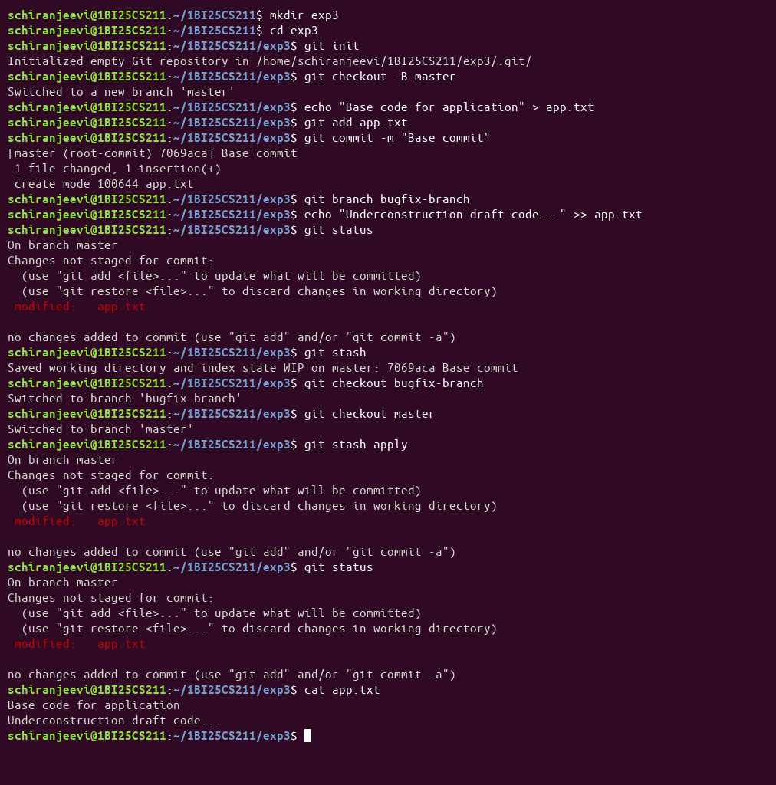

# Program 3: Branching and Git Stash
**Student Name:** S Chiranjeevi  
**USN:** 1BI25CS211  
**Course:** Project Management (With Git) - 1BCSL307A  

## Aim
Write the commands to stash your changes, switch branches, and then apply the stashed changes.

## Step-by-Step Commands & Explanations

### Step 1: Create and navigate into directory for Program 3
```bash
mkdir exp3 && cd exp3
```

### Step 2: Initialize repository and set master branch
```bash
git init && git checkout -B master
```

### Step 3: Create base application file and commit
```bash
echo "Base code for application" > app.txt
git add app.txt
git commit -m "Base commit"
```

### Step 4: Create separate branch 'bugfix-branch'
```bash
git branch bugfix-branch
```

### Step 5: Add uncommitted modifications and check status
```bash
echo "Underconstruction draft code..." >> app.txt
git status
```

### Step 6: Temporarily stash uncommitted changes to get a clean working tree
```bash
git stash
```

### Step 7: Switch to bugfix-branch safely
```bash
git checkout bugfix-branch
```

### Step 8: Switch back to master branch
```bash
git checkout master
```

### Step 9: Reapply stashed modifications to working directory
```bash
git stash apply
```

### Step 10: Verify restored uncommitted changes and view file content
```bash
git status
cat app.txt
```

## Output Screenshot

