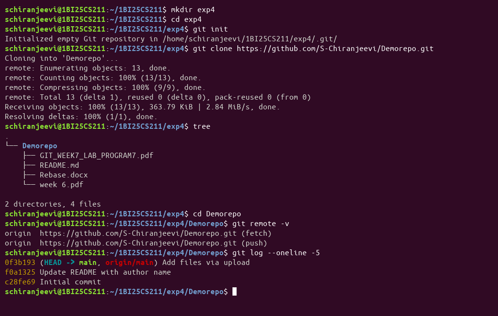

# Program 4: Collaboration and Remote Repositories (Clone)
**Student Name:** S Chiranjeevi  
**USN:** 1BI25CS211  
**Course:** Project Management (With Git) - 1BCSL307A  

## Aim
Clone a remote Git repository to your local machine.

## Step-by-Step Commands & Explanations

### Step 1: Create and navigate into directory for Program 4
```bash
mkdir exp4 && cd exp4
```

### Step 2: Initialize Git repository
```bash
git init
```

### Step 3: Clone remote repository from GitHub
```bash
git clone https://github.com/S-Chiranjeevi/Demorepo.git
```

### Step 4: Display cloned folder tree structure
```bash
tree
```

### Step 5: Navigate into cloned repository directory
```bash
cd Demorepo
```

### Step 6: Inspect remote repository URLs
```bash
git remote -v
```

### Step 7: View the last 5 commits from repository log
```bash
git log --oneline -5
```

## Output Screenshot

