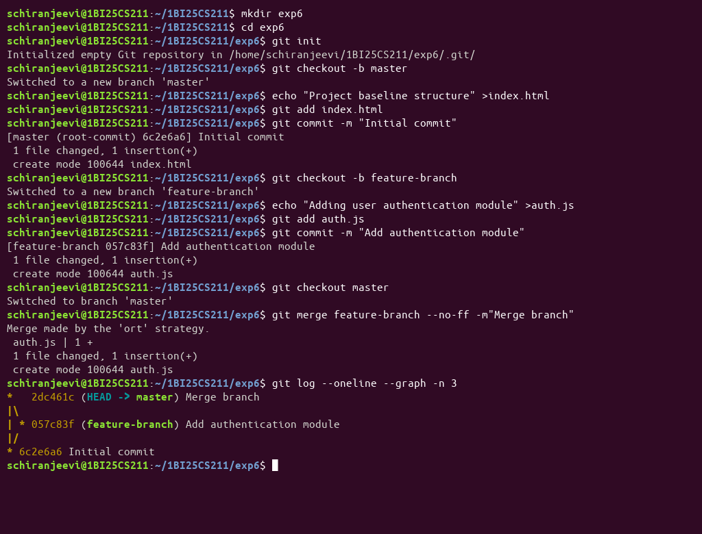

# Program 6: Merging Branches with Custom Commit Message
**Student Name:** S Chiranjeevi  
**USN:** 1BI25CS211  
**Course:** Project Management (With Git) - 1BCSL307A  

## Aim
Write the command to merge 'feature-branch' into 'master' while providing a custom commit message for the merge.

## Step-by-Step Commands & Explanations

### Step 1: Create directory, initialize Git, and switch to master
```bash
mkdir exp6 && cd exp6 && git init
git checkout -b master
```

### Step 2: Create baseline structure file and commit on master
```bash
echo "Project baseline structure" > index.html
git add index.html
git commit -m "Initial commit"
```

### Step 3: Create feature branch, add module file, and commit
```bash
git checkout -b feature-branch
echo "Adding user authentication module" > auth.js
git add auth.js
git commit -m "Add authentication module"
```

### Step 4: Switch back to master branch
```bash
git checkout master
```

### Step 5: Merge feature-branch into master using non-fast-forward (--no-ff) and custom message
```bash
git merge feature-branch --no-ff -m "Merge branch"
```

### Step 6: View merge commit graph
```bash
git log --oneline --graph -n 3
```

## Output Screenshot

