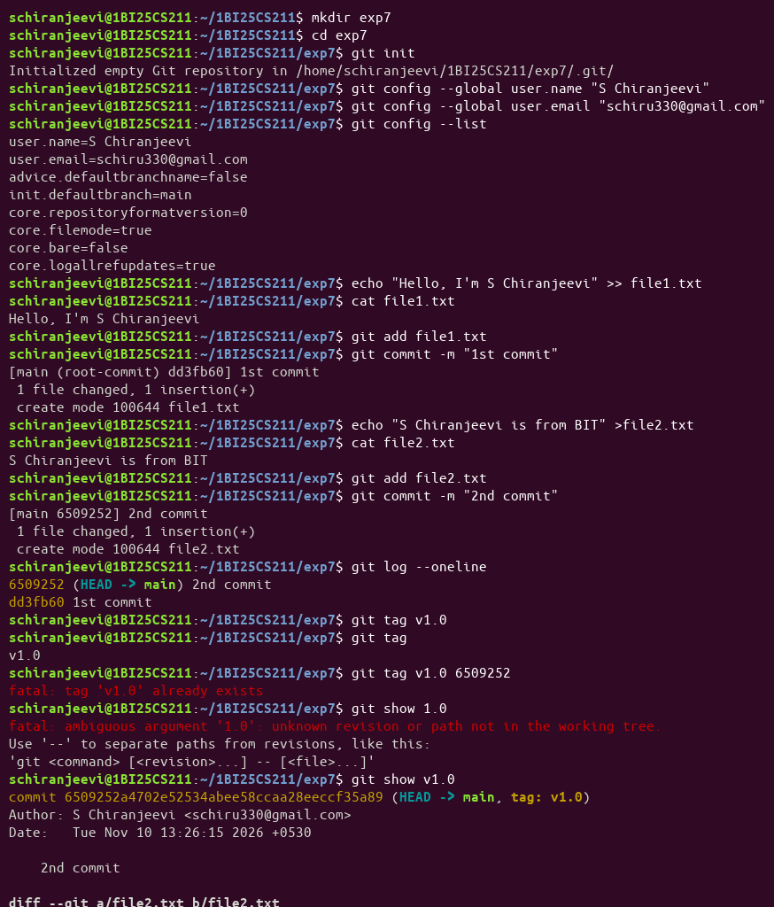

# Program 7: Working with Git Tags
**Student Name:** S Chiranjeevi  
**USN:** 1BI25CS211  
**Course:** Project Management (With Git) - 1BCSL307A  

## Aim
Create, list, verify, and inspect Git tags (release reference points) on commits.

## Step-by-Step Commands & Explanations

### Step 1: Create directory and initialize Git repository
```bash
mkdir exp7 && cd exp7 && git init
```

### Step 2: Configure and inspect user identity
```bash
git config --global user.name "S Chiranjeevi"
git config --global user.email "schiru330@gmail.com"
git config --list
```

### Step 3: Create file1.txt and make 1st commit
```bash
echo "Hello, I'm S Chiranjeevi" >> file1.txt
cat file1.txt
git add file1.txt
git commit -m "1st commit"
```

### Step 4: Create file2.txt and make 2nd commit
```bash
echo "S Chiranjeevi is from BIT" > file2.txt
cat file2.txt
git add file2.txt
git commit -m "2nd commit"
```

### Step 5: Display commit history in one-line format
```bash
git log --oneline
```

### Step 6: Create tag v1.0 and list all tags
```bash
git tag v1.0
git tag
```

### Step 7: Inspect tag metadata, author, and commit diff
```bash
git show v1.0
```

## Output Screenshot

